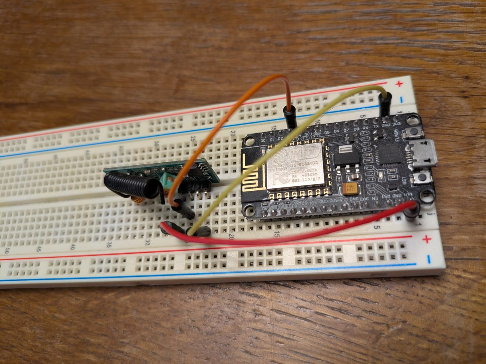

# Warema EWFS Cover Hub for ESPHome

[](https://github.com/tombrain/esphome-warema-cover-hub/actions/workflows/ci.yml)

**English** | [Deutsch](README.de.md)

An [ESPHome](https://esphome.io) external component for controlling Warema EWFS roller blinds over 433 MHz.

It consists of a hub that sends the radio telegrams through a
[`remote_transmitter`](https://esphome.io/components/remote_transmitter.html) and any number of covers.
With a [`remote_receiver`](https://esphome.io/components/remote_receiver.html), the hub also
decodes the telegrams of the original remote, so you can read the codes of your blinds.
The cover position is estimated from the open and close durations, like ESPHome's
[`time_based`](https://esphome.io/components/cover/time_based.html) cover.
A learn button sends the learn key L of a remote, so remotes can be taught from the ESP.

Works with ESP32 and ESP8266, on both the Arduino and the ESP-IDF framework.

> This project is not affiliated with or endorsed by WAREMA. Use it at your own risk.

## Hardware

You need an ESP32 or ESP8266 and a 433 MHz OOK transmitter module, e.g. FS1000A.

| Transmitter | ESP |
|---|---|
| `VCC` | 5 V (the module accepts 3.3–12 V; a higher voltage gives more range) |
| `GND` | GND |
| `DATA` | any free output GPIO, e.g. GPIO4 (ESP32) or D1 (ESP8266) |

The 3.3 V logic level of the ESP is sufficient for `DATA`. On the ESP32, avoid the strapping
pins GPIO0, 2, 5, 12 and 15.

Solder a 17.3 cm wire (a quarter wavelength at 433.92 MHz) to the `ANT` pad of the module.
Without an antenna the range is only a few meters.

The blinds do not report their position. The component estimates it from the run time, so it
drifts when a blind is moved with the original remote.

## Installation

```yaml
external_components:
  - source: github://tombrain/esphome-warema-cover-hub@v1.5.2
    components: [warema_cover_hub]
```

Pin a release tag (`@v1.5.2`). Without it, ESPHome follows the `main` branch.

## Configuration

```yaml
remote_transmitter:
  id: rf_transmitter
  pin: GPIO4
  carrier_duty_percent: 100%   # required for 433 MHz OOK modules

warema_cover_hub:
  id: warema_hub
  transmitter_id: rf_transmitter
  number_of_transmissions: 3

cover:
  - platform: warema_cover_hub
    name: "Cover Bathroom"
    command: "111"
    devicecode1: "101010010"
    devicecode2: "101010011"
    open_duration: 24s
    close_duration: 24s
```

A complete example is in [example.yaml](example.yaml).

### Hub: `warema_cover_hub`

| Option | Required | Default | Description |
|---|---|---|---|
| `id` | no | | ID of the hub. Needed only if you configure more than one hub. |
| `transmitter_id` | no* | | ID of the `remote_transmitter` to send with. |
| `receiver_id` | no* | | ID of a `remote_receiver`. Received telegrams are logged, see [Finding the codes](#finding-the-codes). Own transmissions are filtered out. |
| `number_of_transmissions` | no | `3` | How often each telegram is sent (1–10). |
| `on_unassigned` | no | | Automation for received telegrams of channels without cover or event. See below. |

\* At least one of `transmitter_id` and `receiver_id` is required.

Telegrams are sent round-robin: if several covers are commanded at once, each one gets its
first transmission before any telegram is repeated. A new command for a cover replaces its
pending repetitions, so a STOP is never followed by a leftover OPEN.

### Cover: `platform: warema_cover_hub`

| Option | Required | Description |
|---|---|---|
| `warema_cover_hub_id` | no | ID of the hub. Needed only if you configure more than one hub. |
| `command` | yes | 3-bit channel code of the blind, e.g. `"111"`. |
| `devicecode1` | yes | First 9-bit device code, e.g. `"101010010"`. |
| `devicecode2` | yes | Second 9-bit device code. |
| `open_duration` | yes | Time to fully open. |
| `close_duration` | yes | Time to fully close. |
| `reverse_delay` | no | Pause before reversing a moving cover, default `1s`. See below. |
| `follow_remote` | no | Track keys pressed on the original remote, default `true`. See below. |
| `members` | no | IDs of the covers this channel moves too, e.g. for an "all" channel. See below. |
| `additional_remotes` | no | Codes (`command`, `devicecode1`, `devicecode2`) of further remotes programmed to this blind. See below. |

Plus all [base cover options](https://esphome.io/components/cover/#base-cover-configuration).

The easiest way to get the durations is a stopwatch: open the blind fully once and close it
fully once. The two times may differ.

A Warema receiver stops when it gets the opposite command while moving. So to reverse a
moving cover, the component sends STOP first and the new direction after all STOP
repetitions are sent and `reverse_delay` has passed.

With a receiver on the hub, a cover follows the keys pressed on the original remote, so its
state in Home Assistant stays right: UP and DOWN start it, the opposite key or STOP stops it,
like the motor does. Nothing is sent for this. Pending repetitions of an own command for the
cover are dropped, so they cannot override the remote. Set `follow_remote: false` to turn
this off for a cover.

A channel that moves several blinds, e.g. "all" on the remote, is a cover with `members`.
When it moves, from Home Assistant or the remote, its members follow without sending
anything. A cover can be a member of several channels; groups cannot be nested.

```yaml
cover:
  - platform: warema_cover_hub
    id: living_1
    name: "Living room 1"
    # ...
  - platform: warema_cover_hub
    id: living_2
    name: "Living room 2"
    # ...
  - platform: warema_cover_hub
    name: "Living room all"
    command: "011"
    # ...
    members: [living_1, living_2]
```

If several remotes are programmed to a blind, the cover sends with its own codes only, but
list the codes of the other remotes under `additional_remotes`. Then their keys count for the
cover as well: it follows them, the log and the text sensor show the cover's name, events with
`cover_id` fire, and `on_unassigned` no longer runs for them. For a group channel on another
remote, add its codes to the group cover.

```yaml
cover:
  - platform: warema_cover_hub
    name: "Living room 1"
    command: "011"
    devicecode1: "101010010"
    devicecode2: "101010011"
    # ...
    additional_remotes:
      - command: "001"
        devicecode1: "110011001"
        devicecode2: "110011010"
```

### Switch: `platform: warema_cover_hub`

Shows or hides received codes in the log and the text sensor, e.g. turned on only while
reading new codes. On by default, the state is restored after a reboot. Requires
`receiver_id` on the hub. Events and covers following the remote work regardless of it.
Named "Show Warema codes" unless you set a `name`.

### Text sensor: `platform: warema_cover_hub`

Shows the last received telegram, e.g.
`OPEN, command: 111, devicecode1: 101010010, devicecode2: 101010011 (cover: Bathroom)`.
Requires `receiver_id` on the hub. Named "Received Warema code" unless you set a `name`.

Both take `warema_cover_hub_id` (needed only with more than one hub) and the base
[switch](https://esphome.io/components/switch/#base-switch-configuration) or
[text sensor](https://esphome.io/components/text_sensor/#base-text-sensor-configuration) options.

### Button: `platform: warema_cover_hub`

The button `learn` sends the learn key L with the codes of a cover for `duration`, like
holding L on that remote. Press it again to stop sending early. Requires `transmitter_id` on
the hub.

The button is internal by default: Home Assistant does not get it, it is only on the web
server of the ESP, which needs `include_internal: true` for it. Set `internal: false` to have
it in Home Assistant too.

```yaml
button:
  - platform: warema_cover_hub
    cover_id: bathroom
    learn:
      name: "Bathroom learn"

web_server:
  include_internal: true           # shows the button on the ESP's web page
```

| Option | Required | Description |
|---|---|---|
| `cover_id` | yes | ID of the cover whose codes are sent. |
| `learn` | yes | The learn button, with the base [button options](https://esphome.io/components/button/#base-button-configuration) and: |
| `learn` > `duration` | no | How long L is sent, default `5s`, 1s to 20s. L on a remote has to be held about 3 seconds. |
| `learn` > `internal` | no | Default `true`, so the button is not in Home Assistant. |

#### Learn mode of Warema EWFS receivers

A receiver stores one main channel, the remote taught first, and up to 15 further remotes. It
acknowledges each L it accepts by waving once. Learn mode lasts about a minute and is opened
in one of two ways:

- **Power-up:** switch off the power of the receiver and on again after about 5 seconds. This
  is for the main channel. All receivers on the same circuit are in learn mode then, and all
  of them learn the next L they receive.
- **Main channel:** hold L on the remote with the main channel until the blind waves. This is
  for further remotes; pressing UP or DOWN on the main channel ends learn mode.

Do not switch off the power to teach a further remote: that opens learn mode for a new main
channel. The main remote stays the main channel, further remotes are stored next to it.

The button can be used in three ways. Opening learn mode with the codes of the main remote
has been tested; the rest follows the same Warema procedure.

**Teaching a further Warema remote.** A cover is usually configured with the codes of the
main remote of its blind. Then the hub takes over the part of the main remote, and it reads
the code of the new remote on the way:

1. Press the learn button of the cover. The hub sends L of the main remote. When the blind
   waves, press the button again, so the hub stops sending: while it sends, it does not
   receive. Holding L on the main remote for about 5 seconds does the same.
2. On the new remote, select the channel of the blind and hold L until the blind waves,
   about 5 seconds. The hub receives this L and logs it with the code of the new remote, e.g.
   `Received LEARN, command: 010, devicecode1: 000011010, devicecode2: 011110101 (no cover
   configured)`. The text sensor shows it too, and `on_unassigned` runs with the key `learn`.
3. Move the cover from Home Assistant, up or down. This sends UP or DOWN of the main remote
   and ends learn mode. The blind moves normally again.
4. Add the code from step 2 to the cover under `additional_remotes`, so the cover follows the
   new remote as well.

If the blind does not wave in step 1 or 2, wait about a minute until learn mode has ended and
start again.

**Hub as a further remote.** The cover gets an own code, so the hub no longer depends on the
codes of a remote. The original remote goes under `additional_remotes`, so the cover still
follows it. Pick a code no remote uses; the hub logs a random one at startup (`Random code
for a new remote`), with the device codes starting with 0 like those of all remotes seen so
far. Until it is taught, the blind does not react to the cover.

```yaml
cover:
  - platform: warema_cover_hub
    id: bathroom
    name: "Bathroom"
    command: "111"                 # own code of the hub
    devicecode1: "010110010"
    devicecode2: "001101011"
    # ...
    additional_remotes:            # the original remote
      - command: "111"
        devicecode1: "000101111"
        devicecode2: "010011010"
```

1. Hold L on the remote with the main channel until the blind waves.
2. Press the learn button. When the blind waves, press it again.
3. Press UP or DOWN on the remote with the main channel. This ends learn mode.
4. Move the cover from Home Assistant to check it.

**Hub as main channel.** With an own code as above, the hub can also become the main channel
after a power-up. It then opens learn mode itself, so further remotes can be taught from the
ESP as in the first case.

1. Switch off the power of the receiver and on again after about 5 seconds.
2. Press the learn button. When the blind waves, press it again. Learn mode ends by itself.

Before doing this, keep in mind:

- The receiver has only one main channel, so the hub replaces the main remote. Whether
  further remotes stay stored is not documented by Warema; teach them again if they stop
  working.
- Only do this if the receiver can be switched off on its own. Otherwise all receivers on
  the circuit learn the hub's code as their main channel.
- Keep the codes in your configuration safe. Without them, the main channel can only be
  replaced by another power-up.

### Event: `platform: warema_cover_hub`

Fires an event in Home Assistant for every key pressed on one channel of a remote, so the
remote can trigger automations, e.g. the function keys A, B and C or the keys of a channel
without a blind. Requires `receiver_id` on the hub. Own transmissions do not fire events.

```yaml
event:
  # Channel of a configured cover
  - platform: warema_cover_hub
    name: "Remote Bathroom"
    cover_id: cover_bathroom

  # Channel without a cover
  - platform: warema_cover_hub
    name: "Remote channel 2"
    command: "110"
    devicecode1: "101010010"
    devicecode2: "101010011"
```

| Option | Required | Description |
|---|---|---|
| `cover_id` | one of | ID of a cover whose channel is meant, including its `additional_remotes`. |
| `command`, `devicecode1`, `devicecode2` | one of | The codes of the channel, as for a cover. |
| `warema_cover_hub_id` | no | ID of the hub. Needed only if you configure more than one hub. |

Plus the base [event options](https://esphome.io/components/event/#base-event-configuration).
The event types are `open`, `close`, `stop`, `function_a`, `function_b`, `function_c` and
`learn` (the learn key L).
An automation in Home Assistant reacting to key A:

```yaml
triggers:
  - trigger: state
    entity_id: event.remote_bathroom
    not_from: [unavailable, unknown]
conditions:
  - condition: state
    entity_id: event.remote_bathroom
    attribute: event_type
    state: function_a
actions:
  - action: light.toggle
    target:
      entity_id: light.bathroom
```

## Finding the codes

Each blind is addressed by three codes, which you read from its original remote. The hub can
decode them when you connect a 433 MHz receiver module, e.g. an RXB6 or a cheaper XY-MK-5V.
Connect VCC, GND and DATA like the transmitter. Mind the voltage: the GPIOs of the ESP take
3.3 V only. Run the RXB6 from 3.3 V; the XY-MK-5V needs 5 V and then outputs 5 V on DATA,
so put a voltage divider (e.g. 10 kΩ / 20 kΩ) in front of the GPIO.



A receiver-only setup like this is enough for reading the codes:

```yaml
remote_receiver:
  id: rf_receiver
  pin: D5             # ESP8266 (GPIO14); any free input GPIO on the ESP32
  filter: 400us       # suppresses receiver noise, Warema pulses are at least ~800 µs
  idle: 10ms          # at least 7 ms, syncs are up to 6.8 ms long
  buffer_size: 4kb    # ESP8266 only

warema_cover_hub:
  receiver_id: rf_receiver

# Optional: control and show it in Home Assistant
switch:
  - platform: warema_cover_hub    # named "Show Warema codes" unless you set a name

text_sensor:
  - platform: warema_cover_hub    # named "Received Warema code" unless you set a name
```

Press a button on the remote near the receiver and watch the log (or the text sensor):

```
[I][warema_cover_hub]: Received OPEN, command: 111, devicecode1: 101010010, devicecode2: 101010011 (no cover configured)
```

Copy `command`, `devicecode1` and `devicecode2` into the cover configuration. Once a cover with
these codes is configured, the end of the line shows its name instead, e.g. `(cover: Bathroom)`. Repeat this
for every blind or channel of the remote. A channel that moves several blinds at once
(e.g. "all") has its own `command` and becomes a cover of its own.

A regular `Buffer overflow` warning of `remote_receiver`, e.g. about once a minute, is
usually caused by other 433 MHz devices such as weather sensors: their packets are longer than
the buffer. Only their signal is dropped, so you can hide the warning:

```yaml
logger:
  logs:
    remote_receiver: ERROR
```

Besides `OPEN`, `CLOSE` and `STOP`, the function keys A, B and C of the remote are shown as
`FUNCTION_A` to `FUNCTION_C` and the learn key L as `LEARN`. `UNKNOWN` means a key this component does not know yet. Please
open an issue with the telegram from the debug log.

### Reacting to unassigned codes

`on_unassigned` on the hub runs for each key pressed on a channel that has no cover and no
event, e.g. a new remote. It provides the strings `key` (`open`, `close`, `stop`,
`function_a` to `function_c`, `learn` or `unknown`), `command`, `devicecode1`, `devicecode2` and
`description`. For example, to get a notification in Home Assistant:

```yaml
warema_cover_hub:
  receiver_id: rf_receiver
  on_unassigned:
    - homeassistant.event:
        event: esphome.warema_unassigned
        data:
          key: !lambda "return key;"
          command: !lambda "return command;"
          devicecode1: !lambda "return devicecode1;"
          devicecode2: !lambda "return devicecode2;"
```

```yaml
# Home Assistant automation
triggers:
  - trigger: event
    event_type: esphome.warema_unassigned
actions:
  - action: notify.notify
    data:
      message: >-
        New Warema code: {{ trigger.event.data.key }}, command: {{ trigger.event.data.command }},
        devicecode1: {{ trigger.event.data.devicecode1 }}, devicecode2: {{ trigger.event.data.devicecode2 }}
```

`homeassistant.event` requires the option "Allow the device to perform Home Assistant
actions" of the device in the ESPHome integration.

### Protocol

A telegram has the layout
`S <command bits:8> <command:3> <suffix:3> S <devicecode1:9> S <devicecode2:9> S`.
`S` is a 5000 µs high sync, each bit lasts 1780 µs: `0` is high then low, `1` is low then
high (Manchester code). The command bits and the suffix select the key:

| Key | Command bits | Suffix |
|---|---|---|
| OPEN (UP) | `01110100` | `111` |
| CLOSE (DOWN) | `01110100` | `110` |
| STOP | `00110100` | `001` |
| Function key A | `01110100` | `001` |
| Function key B | `01110100` | `000` |
| Function key C | `01110100` | `101` |
| Learn key L | `01110100` | `100` |

`command` is the channel of the remote, the device codes identify the remote.

## Versioning

This project uses [Semantic Versioning](https://semver.org). Breaking changes to the YAML
configuration increase the major version. See the
[releases](https://github.com/tombrain/esphome-warema-cover-hub/releases) for changes.

### Migrating from 0.x

- The component moved to `components/warema_cover_hub/`.
- `transmitter_pin` is replaced by a `remote_transmitter` and `transmitter_id`.
- The hub's `name` option is gone.
- `warema_cover_hub_id` on covers is optional when there is only one hub.
- The `rc-switch` library is no longer used.

## Credits

The protocol is taken from [aircontrol](https://github.com/rfkd/aircontrol) by
Ralf Dauberschmidt, which controls Warema EWFS devices from a Raspberry Pi.

## License

[GPL-3.0](LICENSE). The position tracking of the cover is derived from ESPHome's
[`time_based`](https://github.com/esphome/esphome/tree/dev/esphome/components/time_based) cover,
which is licensed under GPL-3.0 as part of ESPHome's C++ code.
